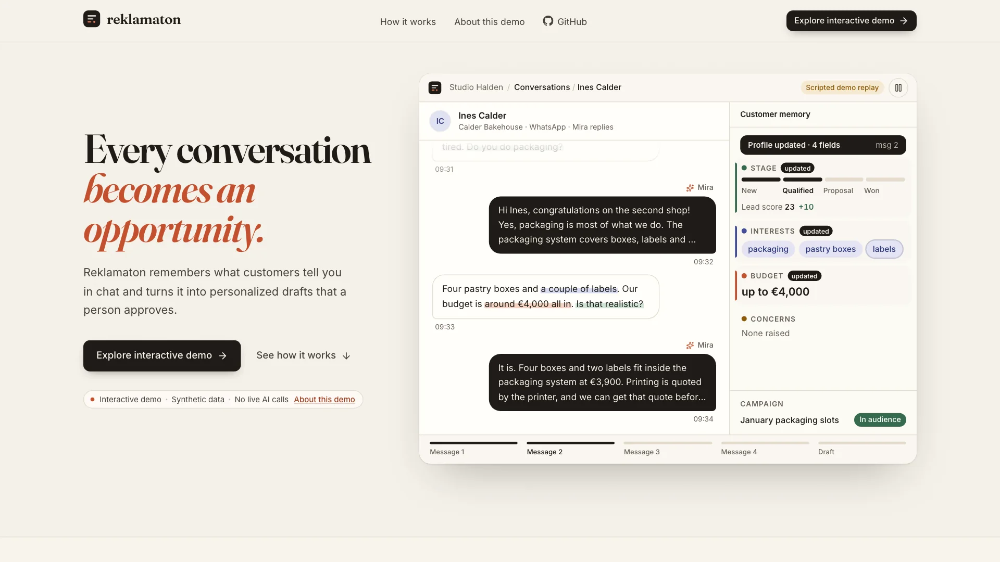
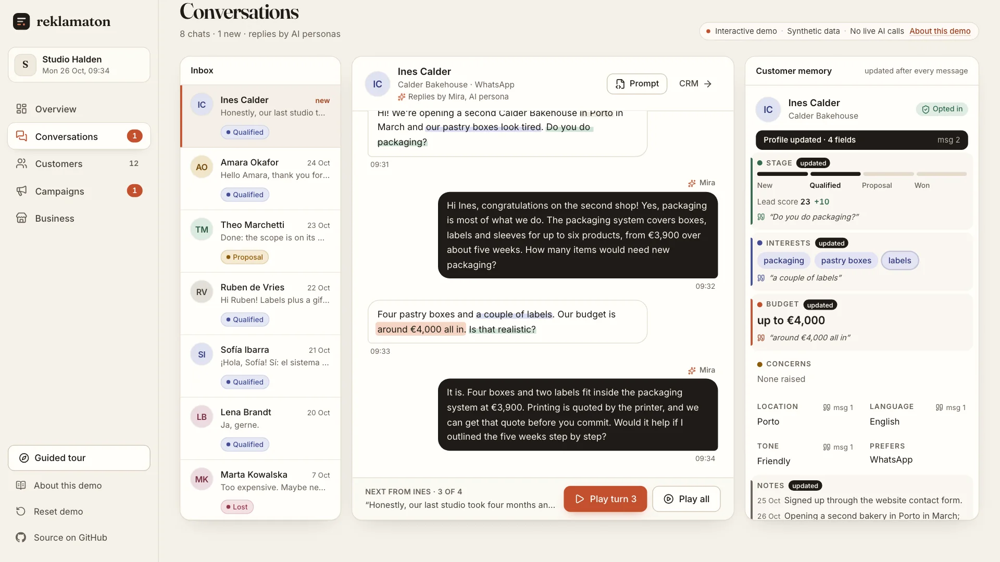
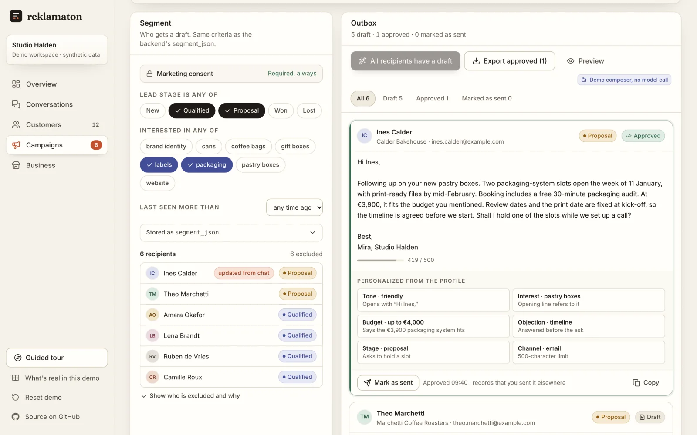
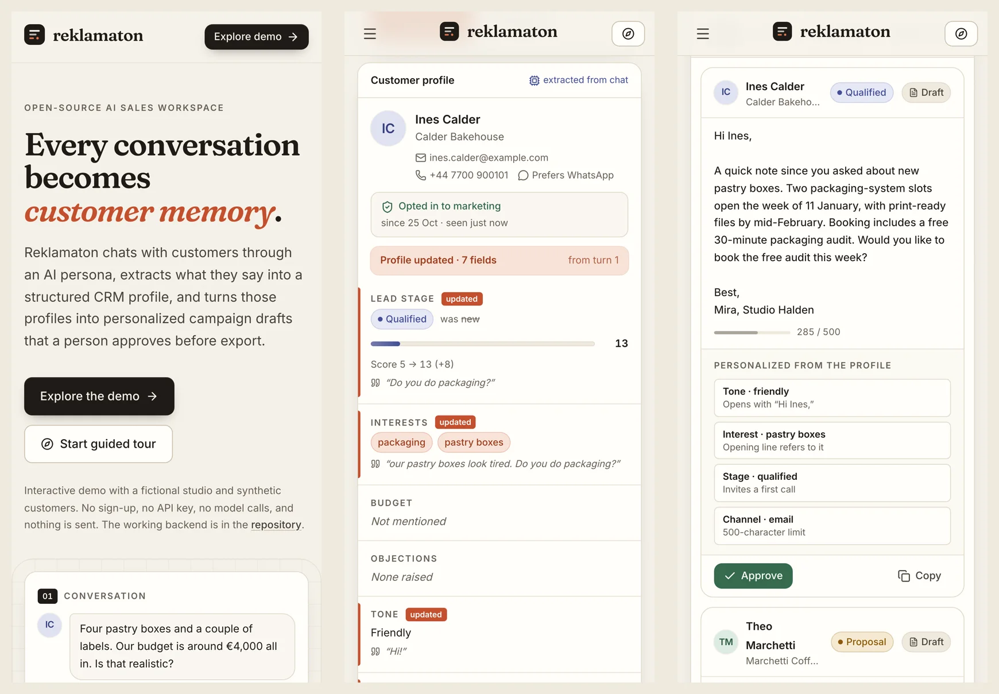
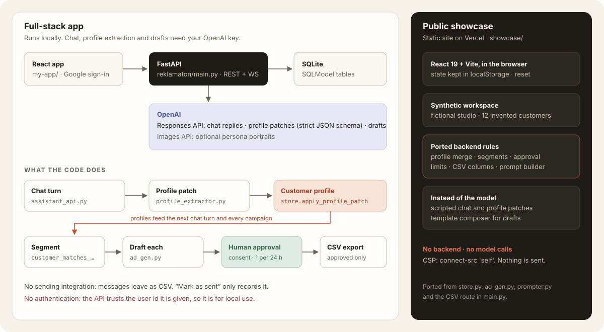
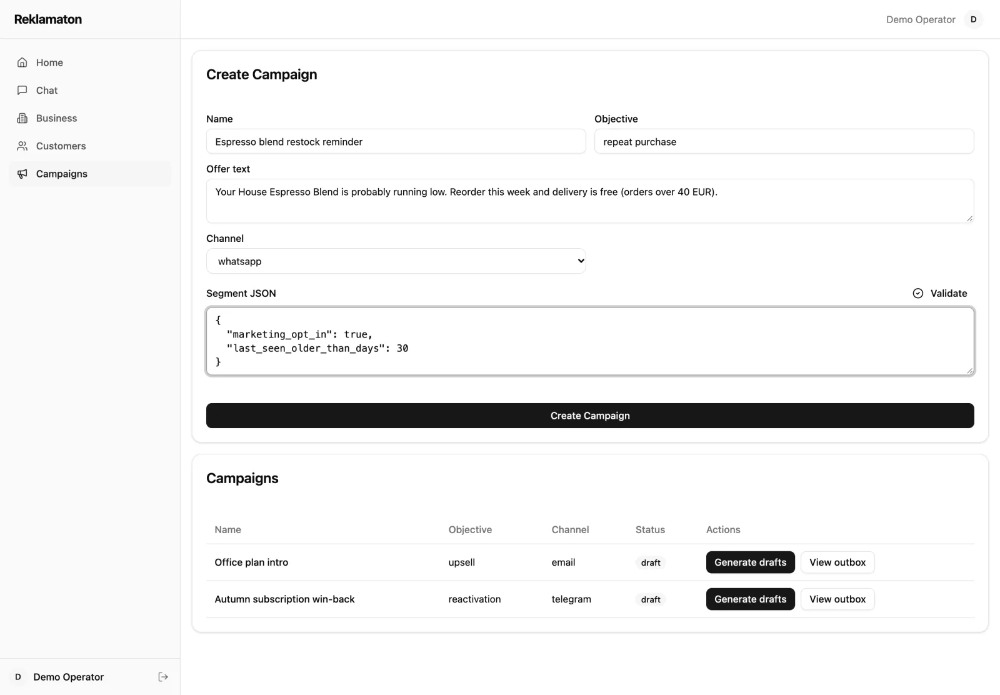

# Reklamaton

**AI-powered customer conversations, memory and personalized outreach.**

Reklamaton is an AI sales workspace. An AI persona chats with a business's customers. After each turn, a model turns what the customer said into a structured CRM profile. Campaigns then use those profiles to draft one personal message per customer, and a person approves each draft before it is exported.

[](https://github.com/tolyaho/reklamaton/actions/workflows/ci.yml)

<p align="center"><a href="https://reklamaton-demo.vercel.app/media/reklamaton-walkthrough.mp4"></a></p>

<p align="center"><b><a href="https://reklamaton-demo.vercel.app">Open the live demo</a></b> · <a href="https://reklamaton-demo.vercel.app/media/reklamaton-walkthrough.mp4">▶ Watch the 54-second walkthrough</a> · <a href="docs/demo.md">What the demo is</a> · <a href="docs/architecture.md">Architecture</a></p>

The live demo is a static site with a fictional studio and synthetic customers. You don't need to sign up or bring an API key. It makes no model calls and sends nothing. The FastAPI backend that does the real work is in this repository and runs locally.

## The workflow

**Business context → Conversation → Customer profile → Segment → Personalized drafts → Human approval → Export**

| Step | What happens | Code |
| --- | --- | --- |
| Business context | Brand voice, a catalog with prices and terms, and AI personas. Every prompt includes them. | [`prompter.py`](reklamaton/prompter.py) |
| Conversation | The persona answers from the catalog only. It never invents prices, and it does not pitch to customers who have not opted in. | [`assistant_api.py`](reklamaton/assistant_api.py) |
| Customer profile | After each turn, a strict JSON-schema call returns a patch: stage, score change, interests, budget, objections, tone, language, location and a note. The patch is merged into the profile. | [`profile_extractor.py`](reklamaton/profile_extractor.py), [`store.py`](reklamaton/store.py) |
| Segment | A campaign selects customers by consent, stage, interests and how long ago they were last seen. | `store.customer_matches_segment` |
| Drafts | One message per customer, built from their profile, in their language and within the channel's length limit. | [`ad_gen.py`](reklamaton/ad_gen.py) |
| Approval | A person approves each draft. Consent is re-checked, and each customer gets at most one approved message per 24 hours across campaigns. | [`main.py`](reklamaton/main.py) |
| Export | The approved messages download as a CSV, with spreadsheet-formula escaping. Reklamaton never sends anything itself. | `GET /outbox/export.csv` |

## Chat in, structured profile out



What makes this more than a chatbot is that the conversation becomes data. The model returns typed fields, not a summary. The merge is conservative:
- "not mentioned" never erases what is already known;
- interests and objections only grow;
- the score moves by a delta and stays within 0–100;
- every update is logged as a customer event.

The next chat turn sees the updated profile, and so does every campaign. In the demo, every fact keeps one colour from her words to the profile field to the draft sentence (interest, budget, concern, intent), and each field links back to the exact words it came from.

## Campaigns a person signs off



Each draft marks the sentences its profile fields produced. For example, Ines's draft:
- refers to her pastry boxes;
- says the €3,900 packaging system fits her €4,000 budget;
- answers her timeline objection;
- asks to hold a slot, because she is at the proposal stage.

Theo's draft cannot be approved, because he already received an approved message from another campaign 3 hours ago.

## The interactive demo

[`showcase/`](showcase/) is a standalone React 19 + Vite app built for this portfolio. It runs the whole loop in your browser:
1. Play Ines's four-turn conversation and watch her profile fill in.
2. See her join the January campaign's audience.
3. Write drafts, approve one and run into the 24-hour rule.
4. Preview and download the CSV.

The landing page opens on the product itself: a window that replays the scripted conversation, then three acts (conversation, memory, campaign) that you can play, inspect, approve and export from on your own copy of the workspace. There is also a guided tour, and a reset button that restores the starting state.

What is real and what is staged:
- **Ported from the Python backend:** the profile merge, segment matching, consent and approval rules, channel limits and CSV columns.
- **Scripted:** the chat replies and the profile patches.
- **Template composer:** the drafts, standing in for the model.

Every scripted or composed piece is labelled as such in the UI. [docs/demo.md](docs/demo.md) maps each screen to the backend code.

<p align="center"></p>

## Architecture



- **Backend:** Python, FastAPI and SQLModel on SQLite.
  - 25 HTTP routes and a streaming WebSocket.
  - OpenAI Responses API for chat replies (`store=False`, the last 20 messages as history), profile extraction (strict JSON schema with a fallback model) and drafts.
  - Optional persona portraits through the Images API.
- **Original frontend** ([`my-app/`](my-app/)): React 19, TypeScript, Vite, Tailwind CSS 4 and Radix, with Google sign-in in the browser.

  
- **Showcase** ([`showcase/`](showcase/)): React 19, React Router, Tailwind CSS 4 tokens, Framer Motion and Radix Dialog.
  - Self-hosted fonts.
  - A Content-Security-Policy that allows connections to its own origin only.

More in [docs/architecture.md](docs/architecture.md).

## Run it

**Demo:**

```bash
cd showcase && npm ci && npm run dev        # http://localhost:5180
```

**Backend.** Use Python 3.11 or newer. Chat, extraction and drafts need `OPENAI_API_KEY`:

```bash
cd reklamaton
python3 -m venv .venv && source .venv/bin/activate
pip install -r requirements-dev.txt
cp .env.example .env                          # add OPENAI_API_KEY to use the LLM features
uvicorn main:app --reload --port 8000         # http://127.0.0.1:8000/docs
```

Without a key:
- the business profile, customers, campaigns, the outbox and CSV export all work;
- starting a chat or generating drafts returns a clear `503 LLM unavailable`.

**Original frontend:**

```bash
cd my-app && npm ci && VITE_API_BASE=http://127.0.0.1:8000 npm run dev -- --port 5174
```

The `Dockerfile` starts both dev servers in one container. It is a local convenience, not a production setup.

## Tests

| | Command | Result |
| --- | --- | --- |
| Backend | `cd reklamaton && pytest` | 32 passed, 2 expected failures. The expected failures record the missing authentication (see below). |
| Showcase unit | `cd showcase && npm test` | 24 passed |
| Showcase browser | `cd showcase && npm run test:e2e` | 30 passed (Playwright, production build, production CSP) |

- **No live model calls in tests or CI.** Model calls go to in-process fakes, so the tests check the requests the code builds and how it handles replies. They do not measure model quality.
- **Browser test failure conditions.** The browser tests fail on any console error, any request to another host, horizontal overflow at 390 to 1920 px, or visible text smaller than 12 px.
- **CI** also lints both frontends, builds them and runs a gitleaks scan.

Details: [docs/evaluation-and-limitations.md](docs/evaluation-and-limitations.md).

## Limitations

- **No authentication.** The API trusts the `user_id` it is given, so the backend is for local use, not the public internet. [docs/security.md](docs/security.md) lists what was fixed (tenant checks on chats, consent at approval and export, CSV injection, request limits, error disclosure, patched dependencies) and what remains.
- **No sending integration.** "Mark as sent" only records that someone sent the message with another tool.
- **No measured results.** The project has no customers, conversion data or time-saving figures, and none are claimed. The demo only counts its own synthetic data.
- **Chat not verified live.** OpenAI shut down the Assistants API on 2026-08-26, so chat now runs on the Responses API. This version of chat has been tested offline only, not against the live API.

## Credits and licence

MIT, see [LICENSE](LICENSE).

The project started in July 2025 as a team prototype by Ho Dang Dung ([@tolyaho](https://github.com/tolyaho)) and Dima Nikuradze ([@nikuradzedima](https://github.com/nikuradzedima)). Dima set up the Docker build and the setup notes. Ho Dang Dung rebuilt it into the sales workspace in 2026 and built the showcase. Parts of the code were written with AI coding assistants (Cursor in the 2026 rebuild, Claude Code for the showcase).

Studio Halden and every person in the demo are fictional.
