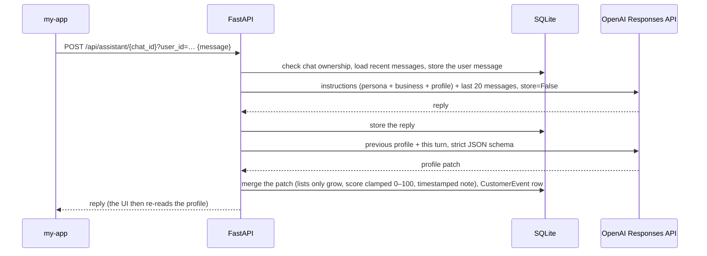

# Architecture

Reklamaton has two parts:

- **The full-stack app**: `reklamaton/` (FastAPI) and `my-app/` (React). It runs locally. Chat, profile extraction and draft generation need an OpenAI API key.
- **The public showcase**: `showcase/`, a static React app. It runs the same workflow in the browser on synthetic data, with no backend and no model.

The diagram describes code paths. Nothing runs as an always-on hosted system: the backend is meant for local use (see [security.md](security.md)), and only the static showcase is deployed.

## Backend (`reklamaton/`)

| Module | Responsibility |
| --- | --- |
| `main.py` | The FastAPI app: 25 HTTP routes and 1 WebSocket. It also handles ownership checks, startup migrations and CSV export. |
| `models.py` | SQLModel tables (User, Business, Customer, CustomerProfile, Campaign, OutboundMessage, CustomerEvent, Avatar, ChatSession, Message), plus request models with size limits. |
| `store.py` | Persistence and rules: customer upsert, the profile merge, segment matching, the 24-hour approval limit and the CSV cell guard. |
| `prompter.py` | The persona prompt and the sales prompt (business context, customer profile, consent rule, channel CTA). |
| `assistant_api.py`, `llm.py` | Chat replies through the Responses API. |
| `profile_extractor.py` | The per-turn profile patch: Responses API with a strict JSON schema, then normalisation. |
| `ad_gen.py` | One campaign draft per customer: language choice, channel limits, a template fallback when the model call fails. |
| `image_gen.py` | Optional persona portraits through the Images API. |
| `seed.py` | Four built-in personas. |

Storage is SQLite (`database.db` in the working directory). A few additive `ALTER TABLE` migrations run at startup.

### One chat turn

`/ws/assistant/{chat_id}` does the same, streaming `response.output_text.delta` events as text frames.

**Why there is no thread state at OpenAI.** Chat used to run on the Assistants API, keeping conversation threads on OpenAI's side. OpenAI shut that API down on 2026-08-26 ([deprecations page](https://developers.openai.com/api/docs/deprecations)), so chat now uses the Responses API. The app's own `Message` table is the history. Each turn sends the most recent `CHAT_HISTORY_LIMIT` messages, default 20, with `store=False`. `ChatSession.thread_id` now holds a local id (`local-…`). Chats created before the change keep working, because their history is read locally.

### One campaign

1. **Segment.** `store.customer_matches_segment` applies `segment_json`:
   - `marketing_opt_in`;
   - `lead_stage_in`;
   - `interests_any`;
   - `last_seen_older_than_days`, where a customer never seen also matches.

   On top of that, `generate_drafts` drops every customer without marketing consent.
2. **Drafts.** `ad_gen.generate_ad_message` sends one Responses API call per customer, with the business, the offer and the customer's profile in the prompt.
   - **Language:** the customer's detected language, otherwise the offer's.
   - **Channel limits:** 160 characters for SMS, 400 for Telegram and WhatsApp, 500 otherwise.
   - **Model failure:** a fixed template is used.
   - **No API key:** the route answers 503 up front.
   - **Size cap:** at most `MAX_DRAFTS_PER_REQUEST` drafts per request (default 50).
3. **Approval.** `POST /outbox/{id}/approve`:
   - refuses a customer without consent (409) and a message already marked as sent (409);
   - allows one approved message per customer per 24 hours across campaigns (429).
4. **Mark as sent.** Allowed only for approved messages. It records that someone sent the message with another tool. Reklamaton has no sending integration.
5. **Export.** `GET /outbox/export.csv` returns the approved messages of customers who still have consent. Columns: `id`, `campaign_id`, `customer_id`, `customer_name`, `contact`, `channel`, `content`, `status`, `approved_at`. Cells that a spreadsheet would run as formulas are prefixed with `'`.

### OpenAI usage

| Call | API | Model (env override) |
| --- | --- | --- |
| Chat reply | `responses.create`, `store=False`, streaming on the WebSocket | `gpt-5-mini`, fallback `gpt-4o` (`OPENAI_CHAT_MODEL`, `OPENAI_CHAT_FALLBACK_MODEL`) |
| Profile patch | `responses.create` with `text.format` = strict `json_schema` | `gpt-5-nano`, fallback `gpt-5-mini` (`OPENAI_PROFILE_EXTRACT_MODEL`, …) |
| Draft | `responses.create` | `gpt-5-nano` (`OPENAI_AD_GEN_MODEL`) |
| Portrait | `images.generate` | `gpt-image-1-mini` (`OPENAI_IMAGE_MODEL`) |

The tests never call OpenAI. `tests/conftest.py` blanks the key, and the chat, extraction and draft tests use in-process fake clients that record the request each module sends.

## Original frontend (`my-app/`)

The React 19 + Vite + Tailwind 4 app has:
- Google sign-in, done in the browser only;
- five views: Home, Chat (with a live profile panel), Business, Customers and Campaigns.

It talks to the backend at `VITE_API_BASE`.

## Showcase (`showcase/`)

The showcase is a standalone Vite app, deployed as a static site. It shares no code with `my-app/`.

| File | Role |
| --- | --- |
| `src/demo/data.ts` | The synthetic workspace: the business, 12 customers, chat histories, Ines's scripted turns and two campaigns. |
| `src/demo/engine.ts` | Ports of `apply_profile_patch`, `customer_matches_segment` and `is_rate_limited_approval`, and the approval checks from `main.py`. |
| `src/demo/compose.ts` | Ports of `_channel_limit`, the truncation and `draft_language`, plus the template composer that stands in for the model. |
| `src/demo/prompt.ts` | Port of `prompter.build_avatar_prompt` and `build_sales_prompt`. |
| `src/demo/csv.ts` | The same export rows and columns as the backend, with the same formula guard. |
| `src/demo/state.ts` | A pure reducer: every screen reads one state, so a profile change shows up everywhere at once. |

A demo clock starts at Monday 26 October 2026, 09:30 Lisbon time, and advances one minute per action. This makes timestamps, and therefore the CSV, reproducible.

The site's Content-Security-Policy allows connections only to its own origin, and the browser tests fail on any request that leaves the local server.

See [demo.md](demo.md) for what is scripted and what is ported.
