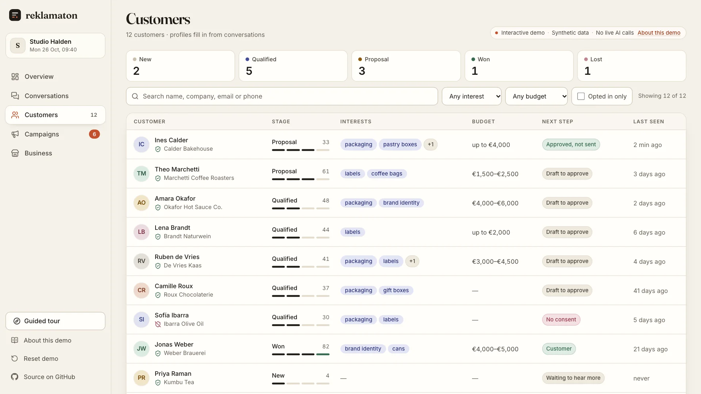

# The interactive demo

The demo is at `showcase/`. It is a static site: it opens without sign-up, needs no API key, makes no model calls and sends nothing. This page describes:
- what the demo shows;
- which parts are scripted;
- how each part relates to the backend.

## Labels used in the demo

| Label | Meaning |
| --- | --- |
| **Synthetic data** | Invented: the business, the people, their contact details and chat histories. |
| **Scripted demo text** | Written for the demo: Ines's four messages, the persona's replies and the profile patch after each turn. Not model output. |
| **Demo composer, no model call** | Campaign drafts assembled by fixed templates from profile fields, standing in for the model call the backend makes. |
| **Backend code / ported rules** | Rules translated line by line from the Python code, such as the profile merge, segments, approval limits and CSV export. |

No recorded model output appears anywhere in the demo. All persona replies are scripted. None of the text was produced by OpenAI.

## The scenario

**Studio Halden** is a fictional brand and packaging studio for food and drink makers, with prices in euros and the Lisbon timezone. Its catalog has six products, from a free packaging audit to a €6,500 website kit. The persona, **Mira**, answers from that catalog.

The workspace starts with:
- 12 customers in different stages;
- 8 conversations;
- two campaigns.

Several customers show the rules at work:

| Customer | Why they are interesting |
| --- | --- |
| Ines Calder | A new lead with a scripted four-turn chat that has not been played yet. |
| Theo Marchetti | Has a message approved 3 hours ago in another campaign, so the 24-hour rule refuses a second one. |
| Lena Brandt | Writes German, so her drafts are in German. Her last approval was 27 hours ago, so she can be approved again. |
| Sofía Ibarra | Matches the campaign but never gave marketing consent, so she is always excluded. |
| Camille Roux | Last seen 41 days ago: the only match for "last seen more than 30 days ago". |
| Marta Kowalska, Jonas Weber | Lost and won customers, outside the campaign's stages. |



Every person in the demo is invented:
- **Emails** use the reserved `example.com` domain.
- **Phone numbers** come from the UK Ofcom range 07700 900000–900999, which is set aside for drama.

No record comes from a real database or from the repository's history.

### Ines's conversation, turn by turn

| Turn | She says (excerpt) | Profile after the merge |
| --- | --- | --- |
| 1 | "…opening a second Calder Bakehouse in Porto in March… Do you do packaging?" | stage new → **qualified**; interests `packaging`, `pastry boxes`; location Porto; tone friendly; language en; score 5 → 13; a note |
| 2 | "Our budget is around €4,000 all in." | budget **up to €4,000**; interest `labels`; score → 23; a note |
| 3 | "Our last studio took four months…" | objection **timeline: last studio took four months**; score → 18 |
| 4 | "Could you email me the packaging plan…?" | stage → **proposal**; score → 33; a note that she prefers email |

Each changed field links back to the words it came from. The quotes are exact substrings of her message, and a unit test checks this.

Turn 1 qualifies her for the January campaign: her stage becomes qualified and she now has a packaging interest. That campaign's draft for her then uses:
- her budget: the €3,900 system fits;
- her timeline objection;
- her proposal stage.

## How each part relates to the backend

| In the demo | In the backend | Same behaviour? |
| --- | --- | --- |
| Persona reply to each turn | `responses.create` with the persona + sales instructions (`assistant_api.py`) | **No.** The demo's replies are scripted. |
| "View prompt": the chat instructions | `prompter.build_avatar_prompt` + `build_sales_prompt` | **Yes**, ported. The only difference: the product list is printed as JSON. |
| Profile patch after each turn | `profile_extractor.extract_profile_patch` (a model with a strict JSON schema) | **No.** The demo's patches are scripted, but they use the same schema and value sets. |
| Merging the patch | `store.apply_profile_patch` | **Yes**, ported: lists only grow, the score is clamped to 0–100, notes are timestamped, and an event is logged. |
| Segment builder | `store.customer_matches_segment` + the consent filter in `generate_drafts` | **Yes**, ported. The demo's `segment_json` preview is what the backend stores. |
| Draft text | `ad_gen.generate_ad_message` (one model call per customer) | **No.** The demo uses the template composer. Its language choice, channel limits and truncation are ported. |
| Approve / mark as sent | `POST /outbox/{id}/approve`, `/mark_sent` | **Yes**: the consent check, one approval per customer per 24 h, "mark as sent" only after approval, and no re-approving a sent message. |
| Consent switch in a customer's drawer | `PATCH /business/{id}/customers/{id}` | **Yes**: the opt-in timestamp is set or cleared, and the customer leaves segments and exports. |
| CSV export and preview | `GET /outbox/export.csv` | **Yes**: same rows, columns and formula guard. |

### Behaviour that only exists in the demo

1. **Generate drafts** writes drafts only for recipients without one. The backend writes a new draft on every call.
2. **Rewrite draft** appears when a profile changed after its draft was written, and it replaces the draft in place. In the backend you would call `generate_drafts` with `customer_ids`, which adds a new draft.
3. **The composer** reads structured fields only, not notes. It has English and German templates; for other languages it falls back to English and says so in the draft's factors.
4. **The demo clock** starts at Monday 26 October 2026, 09:30 Lisbon time, and moves one minute per action. This keeps the output reproducible.
5. **The downloaded CSV** starts with a UTF-8 byte-order mark so spreadsheet apps read the umlauts. The backend's file has no BOM.
6. **Customer search** also matches the company name. The backend searches name, email, phone and external id.
7. **State** lives in the browser's `localStorage`. **Reset demo** restores the start.

## What "marked as sent" means

Reklamaton has no SMS, WhatsApp, Telegram or email integration.
- **Approved messages** leave the app as a CSV file or as copied text.
- **"Mark as sent"** records that someone sent the message with another tool, and removes it from the export queue.

Neither the demo nor the backend delivers any message, and neither produces delivery receipts.

## The guided tour

The tour has 10 steps. It moves through the real screens and uses the real demo actions: Play turn, Generate drafts, Approve and Download CSV.
- You can skip, go back, restart, or close it with Escape.
- It never blocks the page.
- Steps that wait for an action move on by themselves once you do it.

## Video

The README video (about 57 seconds, 1920×1080, 30 fps, H.264) was recorded by `showcase/scripts/record-demo.mjs`:
1. Playwright drives the production build.
2. The Chrome DevTools screencast captures every frame with its timestamp.
3. FFmpeg resamples the frames to a constant 30 fps.

Two things are drawn on top for the video only: a round pointer, because headless browsers have no cursor, and the closing card. The playback timing is the app's own presentation timing. Nothing is sped up or generated.

```bash
cd showcase
npm run build && npx vite preview --port 4180 &
node scripts/record-demo.mjs --base http://localhost:4180 --site <public host> --out scripts/out
```
